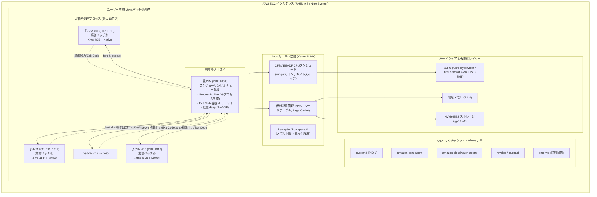
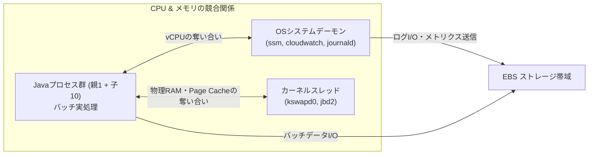

# EC2 (RHEL 9.8) × OpenJDK 21 親子JVMバッチ並列処理 性能・リソース完全設計解説書

---

## 1. エグゼクティブサマリ・システム全体像

本ドキュメントは、**AWS EC2（Red Hat Enterprise Linux 9.8）** 環境において、**OpenJDK 21（LTS）** を用いて稼働する **「1つの親JVMが司令塔となり、10個の子JVMを並列起動して実業務バッチを実行する」** アーキテクチャについて、その内部動作原理、リソース関連性（プロセス、メモリ、vCPU、OSデーモン）、登場の歴史的背景、性能試験における調査コマンド（`sar` 等）の監視ポイント、サイジング計算モデルを網羅的かつ極めて詳細に解説した技術設計書です。

### 1.1 システム構成概要

- **クラウドインフラ**: AWS EC2（AWS Nitro System 搭載インスタンス）
- **オペレーティングシステム**: Red Hat Enterprise Linux 9.8（Linux Kernel 5.14+ / cgroups v2 有効）
- **Javaランタイム**: OpenJDK 21.0.x 64-Bit Server VM（LTS）
- **並列度設計**:
  - **親JVM（Master / Orchestrator）**: 1プロセス（ジョブ管理、並列度制御、監視、リトライ制御）
  - **子JVM（Worker / Batch Execution）**: 最大10プロセス並列（実際の重い業務ロジックを実行）
  - **合計Javaプロセス数**: **11プロセス**
  - **総OSネイティブスレッド数**: **約300～500本以上**（各JVMのGC、JIT、アプリスレッド合算）



---

## 2. 小学生でも完全にわかる動作原理とイメージ

難しいIT用語を、**「学校の校舎・校長先生・10の特別工作教室」** という誰でも知っている世界に例えて、この仕組みの動きとメリットを直感的に解き明かします。

### 2.1 たとえ話の登場人物・部品一覧

| ITの専門用語 | 学校にたとえると何？ | 役割と具体的なお仕事 | もしトラブルが起きたら？ | なぜこの仕組みが必要？（メリット） |
| :--- | :--- | :--- | :--- | :--- |
| **EC2 インスタンス** | **学校の校舎全体** | 生徒たちが作業するための建物全体。建物の広さ（メモリ）と、先生の頭脳（vCPU）の上限が決まっている。 | 校舎が停電すると、全員の宿題・作業が一瞬で止まります。 | クラウド上に頑丈で自分たち専用の校舎を借りて作業できる。 |
| **vCPU（仮想CPU）** | **先生の「頭脳と両手」** | 計算ドリルを解いたり、文字を書いたり、実際に頭と手を動かして作業を進める力。 | 仕事が多すぎて先生の頭がパンクすると、生徒たちの順番待ち（待ち行列）が長くなります。 | 先生の頭と手の数（vCPU数）が多ければ多いほど、たくさんの仕事を同時に進められる。 |
| **物理メモリ（RAM）** | **教室にある「大きな作業机」** | 今すぐ使うノートや筆記用具を広げておく場所。机が広いほどたくさんの資料を一度に広げられる。 | 机の上が物で溢れかえると、作業ができなくなって警備員に部屋から追い出されます（OOM Killer）。 | 引き出し（SSD/ハードディスク）から取り出すより、机の上（メモリ）にある方が10万倍速く作業できる！ |
| **スワップ領域（Swap）** | **廊下に置かれた「荷物の一時退避ダンボール」** | 机がいっぱいになった時、たまにしか使わないノートを廊下の箱に一時退避させる仕組み。 | 廊下までノートを取りに行くとすごく時間がかかるので、作業スピードがカメのように遅くなります。 | 完全に机から溢れて作業が全滅するのを、スピードを極端に落としてでもギリギリ防ぐ安全装置。 |
| **親JVM（Master）** | **職員室の「校長先生」** | 「次はこのバッチ宿題をやってね」と指示を出し、10個の特別教室を見守る司令塔。自分では絵の具を使いません。 | 校長先生が倒れると次の宿題の指示が出せなくなります（でも自分は重労働をしないので滅多に倒れません）。 | 校長先生自身は絶対に汚れる作業をしないことで、学校全体の指揮が絶対にストップしないように守る。 |
| **子JVM（10並列）** | **10個の「独立した特別工作教室」** | 校長先生から宿題をもらって、実際に絵の具やノコギリを使って重い工作（バッチ実処理）を集中して行う部屋。 | 1つの教室で絵の具をぶちまけて大爆発（メモリパンク）しても、その部屋だけが片付けられます。 | **【最大のポイント！】他の9個の教室と職員室は頑丈な壁で仕切られているので、汚れが絶対に飛び散らない！** |
| **JVMヒープメモリ（-Xmx）** | **各教室の中に置かれた「生徒の個人机」** | 生徒が絵の具や画用紙を広げるスペース。この広さを超えて画用紙を広げようとすると怒られます。 | 机の端を超えて物を置こうとすると「もう置けません！（OutOfMemoryError）」と叫んで止まります。 | 生徒ごとに「あなたの机はこの広さまでね」と上限を決めておくことで、校舎全体の机を独り占めさせない。 |
| **JVMメタスペース** | **教室の壁にある「教科書の本棚」** | プログラムのルールやクラスの設計図（教科書）を置いておく場所。生徒の個人机とは別の専用の本棚。 | 本棚が溢れると、新しい教科書が読めなくなって作業が止まります。 | 生徒の作業机（ヒープ）と、教科書の棚（メタスペース）を分けることで整理整頓される。 |
| **OS（Linuxカーネル）** | **学校の「厳格な警備員兼管理人」** | 誰がどの頭脳（CPU）を何秒使うか秒単位で交通整理し、机の空き具合を24時間見回る管理人。 | 誰かが暴走して学校のルールを壊しそうになると、強制的に部屋から叩き出します（kill -9）。 | みんなが勝手なことをして学校全体が崩壊しないよう、公平かつ厳しく秩序を守る。 |
| **Linux OOM Killer** | **暴走した生徒を強制退去させる「警備員」** | 学校全体の机（メモリ）が本当にゼロになった時、一番机を散らかしている部屋を強制閉鎖する。 | 警告なしで一瞬で部屋から叩き出されます（exit code 137）。 | 学校全体が倒壊（OSクラッシュ）するのを防ぐため、一番机を散らかした部屋を身代わりに倒す苦肉の策。 |
| **sar コマンド** | **学校全体の「監視カメラと健康診断計」** | 「先生の頭は疲れてないか？」「机はどれくらい埋まってるか？」「廊下を走ってる人は何人か？」を1秒ごとに記録。 | 過去の記録をいつでも見返して、「昨日の夜22時に誰がサボっていたか・苦しんでいたか」を特定できます。 | どこが苦しいのか（CPUなのか、メモリなのか、机の広さなのか）が一目でわかる！ |

---

### 2.2 なぜ「1つの大部屋で10人作業」ではなく「10の小部屋に分ける」のか？

```
【方式A: 1つの大部屋で10人が一緒に作業】（単一JVMマルチスレッド）
┌────────────────────────────────────────────────────────┐
│ 1つの部屋（単一JVM）                                    │
│ ［生徒1］ ［生徒2］ ［生徒3］ ［生徒4］ ［生徒5］ ...   │
│                                                        │
│  ※ もし生徒3がバケツのインクを床にぶちまけたら（OOM発生） │
│  ⇒ 全員の足元が汚れて、10人全員の作業が即座に強制中断！ │
└────────────────────────────────────────────────────────┘

【方式B: 10個の独立した小部屋で別々に作業】（本システムの親子JVM構成）
┌──────────┐ ┌──────────┐ ┌──────────┐ ┌──────────┐
│ 特別室 #1 │ │ 特別室 #2 │ │ 特別室 #3 │ │ 特別室 #4 │ ...
│ ［生徒1］ │ │ ［生徒2］ │ │ ［生徒3］ │ │ ［生徒4］ │
└──────────┘ └──────────┘ └──────────┘ └──────────┘
                              ↓ インクをぶちまけた！
                         部屋#3だけ閉鎖・片付け！
                         （部屋#1, #2, #4～#10は全くの無傷で作業続行！）
```

- **方式A（単一JVM）**: 1つの部屋なので準備は一瞬ですが、**誰か1人の失敗が全員の連帯責任になり、全員が全滅する** という致命的な欠点があります。
- **方式B（親子JVM）**: 部屋を10個作るので少しだけ部屋代（メモリ）を食いますが、**誰かが大爆発を起こしても他の部屋には1ミリも被害が出ず、終わったら部屋ごと綺麗に片付けられる** という圧倒的な安全性が手に入ります。

---

## 3. 登場の歴史と背景・必要になった経緯

なぜエンタープライズのバッチ処理システムは、この「親子JVMによるマルチプロセス構成」にたどり着いたのでしょうか？コンピュータとJavaの50年にわたる歴史を振り返ると、その技術的必然性が見えてきます。

### 3.1 世代別のバッチ処理アーキテクチャ進化史

```
1970s～1990s: 【第1世代 メインフレーム・UNIX C/Shell】
  ジョブごとにOSプロセス起動。ハードウェア資源を排他的利用。極めて堅牢だが専用機が高価。
      ↓（オープン化・Javaの登場）
2000s～2010s: 【第2世代 単一巨大JVM マルチスレッド型】
  1つの巨大Javaプロセス内で複数スレッド並列稼働（Spring Batch等）。起動は速いが「単一JVMの悲劇」が多発。
      ↓（エンタープライズの痛烈な反省）
2015s～現在 : 【第3世代 親子JVM マルチプロセス分離型（本アーキテクチャ）】
  親JVMが子JVMをProcessBuilderで起動。OSの仮想記憶（MMU）による完全な障害隔離とメモリ回収を実現。
      ↓（クラウドネイティブ・最新LTS）
2023s～最新 : 【第4世代 OpenJDK 21 × AWS Nitro クラウド最適化】
  AppCDSによる高速化、Generational ZGC/G1GCの低遅延化、Nitroによるハードウェアオフロード。
```

### 3.2 第2世代が直面した「単一JVMの4大悲劇」

2000年代、多くの企業がJavaでバッチシステムを構築した際、「1つのJVMを起動し、その中で10本～50本のスレッドを立ち上げて並列処理を行う」構成が主流でした。しかし、本番環境で数々の致命的な障害を引き起こしました。

1. **爆風域（Blast Radius）の広大さ（連座倒れ）**:
   Javaにおける `OutOfMemoryError: Java heap space` は、メモリを要求した任意のスレッドでスローされます。この結果、ロックを持ったままスレッドが死亡してデッドロックを起こしたり、JVM内部の整合性が崩壊してJVM全体が応答不能（ハング）になり、**「たった1つのバッチの不具合で、同時に走っていた無関係な9つの重要バッチが道連れで全滅する」** という惨劇が発生しました。
2. **Stop-The-World（STW）GC による全ジョブ凍結**:
   10個のバッチを同時に動かすため、巨大なヒープ（32GB～64GB以上）を割り当てていました。旧来のGC（Parallel GCやCMS）では、Old領域が枯渇した際の **Full GC でシステム全体が数十秒～数分間完全に停止（STW）** し、夜間バッチの締め切り時間（バッチウィンドウ）を突き抜ける原因となりました。
3. **長期稼働によるメモリ腐敗（静的変数・ClassLoaderリーク）**:
   単一JVMが何日も動き続けると、誰かが書いた `static` コレクションへの参照の消し忘れ、`ThreadLocal` のクリーンアップ漏れ、JDBCドライバのロード解除失敗によってMetaspaceやヒープが徐々に腐敗していきました。
4. **ネイティブクラッシュ（SIGSEGV）による即死**:
   OracleやPostgreSQLのJDBCネイティブドライバ、あるいはC言語で書かれた暗号化ライブラリ（JNI）がセグメンテーション違反（SIGSEGV）を起こすと、**Javaの例外処理をすり抜けてOSレベルでJVMプロセスが一瞬で死滅（Process Abort）** しました。

### 3.3 親子JVMマルチプロセス構成の必然性とメリット

こうした手痛い教訓から生まれたのが、本システムで採用されている **「親JVM ＋ 子JVMマルチプロセス構成」** です。

- **OS仮想記憶（MMU）による物理的分離**: 子プロセス同士は独立したアドレス空間を持つため、ある子JVMがOOMになろうが、SIGSEGVで即死しようが、他の子JVMと親JVMには1ビットの影響も与えません。
- **完璧なメモリ返却**: 子JVMが業務を終えて終了（`exit`）すると、**Linuxカーネルがそのプロセスが使っていた物理メモリ、仮想メモリ、ファイル記述子を100%回収** します。Javaアプリ側のメモリリークの有無にかかわらず、次のバッチは常に真っ新な状態でスタートできます。
- **個別サイジングの柔軟性**: バッチAには `-Xmx2g`、巨大バッチBには `-Xmx8g` というように、ジョブの特性に合わせたJVMチューニングが可能です。

---

## 4. プロセス・メモリ・vCPUの動作原理と関連性

ここからは、Linux OS（RHEL 9.8）と OpenJDK 21 の低レイヤーに深く踏み込み、プロセス、メモリ、vCPUがどのように相互作用しているのかを徹底解剖します。

### 4.1 プロセスとスレッドの内部構造（OS vs OpenJDK 21）

Linuxカーネルには、厳密には「スレッド」という独立したオブジェクトは存在しません。すべては **`task_struct`** という構造体で管理される「タスク」です。

- **プロセス**: 独立した仮想アドレス空間（`mm_struct`）を持つタスク。親JVMと10個の子JVMは、それぞれ固有の `mm_struct` を持つため、アドレス空間が完全に隔離されています。
- **スレッド**: `clone()` システムコール時に `CLONE_VM`（メモリ空間共有）、`CLONE_FILES`（ファイル記述子共有）を指定して生成された軽量プロセス（LWP: Light Weight Process）。JVM内部のJavaスレッドは、Native POSIX Thread Library（NPTL）を介して、Linuxの1つのNativeスレッド（1:1スレッドモデル）に対応します。

```
【11個のJavaプロセスとOSスレッドの関係】
親JVM (PID: 1001)   ── OSスレッド: 約20本 (Main, GC, JIT, 監視)
子JVM #01 (PID: 1010) ── OSスレッド: 約35～50本 (Main, Worker×N, G1GC×2, JIT×2...)
子JVM #02 (PID: 1011) ── OSスレッド: 約35～50本
  ...
子JVM #10 (PID: 1019) ── OSスレッド: 約35～50本
────────────────────────────────────────────────────────────────
★ システム全体でのJavaスレッド総数: 約 370 ～ 520 本のOSネイティブスレッド！
```

> [!WARNING]
> **GCスレッドの爆発（GC Thread Explosion）の罠**:
> OpenJDK 21のG1GCは、デフォルトでホストのvCPU数に応じたGC並列スレッド（`ParallelGCThreads`）を生成します。例えば16 vCPUの環境では、1つのJVMがデフォルトで **13本のGCスレッド** を起動します。
> もし子JVM 10個をデフォルト設定のまま起動すると、**10 JVM × 13本 ＝ 130本のGCスレッド** が同時に立ち上がり、バッチの裏で16個のvCPUを奪い合うことになり、激烈なコンテキストスイッチと性能劣化を引き起こします。**子JVM側で明示的にスレッド数を制限するチューニング（後述）が必須** です。

---

### 4.2 JVMメモリの内部内訳（なぜ 10 × -Xmx ではないのか？）

性能試験で最も多い事故が、**「子JVMの -Xmx を4GBにしたから、10並列で40GBだな」** と考えてメモリをサイジングし、本番高負荷試験で **Linux OOM Killer に子プロセスを撃ち殺される** パターンです。

JVMが消費する実メモリ（RSS: Resident Set Size）は、Java Heap 以外に膨大な **Non-Heap（ネイティブメモリ）** を含みます。

```
┌────────────────────────────────────────────────────────────────────────────────────────┐
│ 1つの子JVMプロセスの総メモリ消費（OSから見たRSS）                                       │
│                                                                                        │
│  ┌───────────────────────────────────────────────┐ ┌────────────────────────────────┐  │
│  │ Java Heap (-Xmx)                              │ │ Non-Heap / Native Memory       │  │
│  │ ┌───────────────────────┬───────────────────┐ │ │ ┌────────────────────────────┐ │  │
│  │ │ Young Generation      │ Old Generation    │ │ │ │ Metaspace (-XX:MaxMetaspace)│ │  │
│  │ │ (Eden + S0 + S1)      │                   │ │ │ ├────────────────────────────┤ │  │
│  │ └───────────────────────┴───────────────────┘ │ │ │ CodeCache (-XX:ReservedCode) │ │  │
│  └───────────────────────────────────────────────┘ │ ├────────────────────────────┤ │  │
│                                                    │ │ Thread Stacks (-Xss × 本数)  │ │  │
│                                                    │ ├────────────────────────────┤ │  │
│                                                    │ │ Direct Byte Buffers (NIO)  │ │  │
│                                                    │ ├────────────────────────────┤ │  │
│                                                    │ │ GC内部構造体 (CardTable等)   │ │  │
│                                                    │ ├────────────────────────────┤ │  │
│                                                    │ │ glibc malloc / Cランタイム   │ │  │
│                                                    │ └────────────────────────────┘ │  │
│                                                    └────────────────────────────────┘  │
└────────────────────────────────────────────────────────────────────────────────────────┘
```

#### 各メモリ領域の詳細と10並列時の影響

| メモリ領域 | 分類 | 制御引数 | 1プロセスあたりの目安 | 10並列時の総消費 | 枯渇時の挙動・注意点 |
| :--- | :--- | :--- | :--- | :--- | :--- |
| **Java Heap** | Heap | `-Xms`, `-Xmx` | 4.0 GB | **40.0 GB** | `OutOfMemoryError: Java heap space` が発生。当該子プロセスのみ終了。 |
| **Metaspace** | Non-Heap | `-XX:MaxMetaspaceSize` | 約 250 MB | **約 2.5 GB** | クラスメタデータ領域。未設定だと無制限にOSメモリを消費し、OS RAMを枯渇させる。 |
| **CodeCache** | Non-Heap | `-XX:ReservedCodeCacheSize`| 約 128 MB | **約 1.3 GB** | JITコンパイル済みネイティブ機械語の保存領域。枯渇するとJITが停止し低速化。 |
| **Thread Stack** | Off-Heap | `-Xss`（標準1024KB） | 約 40 MB（40スレッド時） | **約 0.4 GB** | メソッド呼出スタック。1スレッドあたり1MBを消費。スレッド数に比例。 |
| **Direct Memory** | Off-Heap | `-XX:MaxDirectMemorySize` | 約 200 MB | **約 2.0 GB** | NIO、Netty、JDBCドライバがゼロコピー転送で使うオフヒープバッファ。 |
| **GC内部構造体** | Native | GCアルゴリズム依存 | 約 150 MB | **約 1.5 GB** | G1GCのRemembered Set（RSet）、Card Table、Marking Bitmap等の管理構造体。 |
| **glibc malloc** | Native | `MALLOC_ARENA_MAX` 等 | 約 100 MB | **約 1.0 GB** | Linux C標準ライブラリのマルチスレッドメモリアリーナによる断片化オーバーヘッド。 |
| **【実RSS合計】** | **合計** | **上記すべての合算** | **約 4.85 GB / JVM** | **約 48.7 GB** | **Heap単体（40GB）に対して、Non-Heapだけで＋8.7GB以上も余分に消費される！** |

---

### 4.3 OS物理メモリ・ページキャッシュ・スワップ・OOM Killer

Linuxカーネルは、物理メモリ（RAM）を以下のように管理しています。

```
┌────────────────────────────────────────────────────────────────────────────────┐
│ EC2 物理メモリ（RAM: 例 64GB）                                                  │
│ ┌─────────────────────────┬──────────────────────┬─────────────┬─────────────┐ │
│ │ 子JVM群 実RSS (約48.7GB) │ 親JVM RSS (約2.0GB)  │ OSデーモン  │ ページ      │ │
│ │ (10プロセス分)          │ (司令塔)             │ (約2.0GB)   │ キャッシュ  │ │
│ │                         │                      │ (systemd等) │ (約11.3GB)  │ │
│ └─────────────────────────┴──────────────────────┴─────────────┴─────────────┘ │
└────────────────────────────────────────────────────────────────────────────────┘
```

1. **ページキャッシュ（Page Cache）の死活的重要性**:
   バッチ処理は、大量のデータファイル（CSV、ログ、中間ファイル）を読み書きし、データベースともソケット通信を行います。Linuxカーネルは、空いているRAMを自動的に「ページキャッシュ」として利用し、ディスクI/Oをミリ秒からナノ秒レベルへ加速します。
   もしJVMのヒープを欲張ってRAMギリギリまで割り当てると、**ページキャッシュが極限まで押し出されて消滅し、ファイルI/OのたびにNVMe EBSへの物理アクセスが発生して、バッチ処理速度が10倍～100倍低下** します。
2. **スワップ（Swap）の恐怖**:
   RAMが不足すると、カーネルはメモリの一部をスワップ領域（ディスク）へ追い出します。JavaのGC（ガベージコレクション）は、ヒープ全体をスキャンしてオブジェクトの生存を確認します。もしヒープの一部がスワップアウトされていると、**GCスキャンのたびに大量のディスク読み込み（メジャーページフォルト）が発生し、通常のGC停止時間が数十ミリ秒から数分間に跳ね上がり、システムが完全にフリーズ** します。
3. **Linux OOM Killer の発動メカニズム**:
   物理RAMとスワップが完全に枯渇すると、Linuxカーネルの `out_of_memory()` 関数が発動します。カーネルは各プロセスのメモリ消費量と `oom_score_adj` から悪質度（`badness`）を計算し、**「最もメモリを多く消費しているプロセス」を容赦なく `SIGKILL`（kill -9）で即死** させます。
   10個の子JVMのうち、最もヒープを使っていた子プロセスが突然消滅し、親プロセスには無情にも **Exit Code 137（128 + SIGKILLのシグナル番号9）** だけが返されます。

---

### 4.4 CPUとvCPUのスケジューリング（AWS Nitro & Linux CFS）

#### 1. AWS EC2における「vCPU」の物理的実体
EC2における **1 vCPU** は、基本的には物理CPUコアの **1つのハードウェアスレッド（Intel Hyper-Threading / AMD SMT）** です。
1つの物理コアには2つのvCPUが紐づいており、演算器（ALU/FPU）やL1/L2キャッシュを共有しています。そのため、片方のvCPUが暗号化や行列計算で演算器をフル回転させている場合、もう片方のvCPUの処理能力は物理コアの50%～60%程度に制限されます。

#### 2. AWS Nitro System の恩恵
旧世代の仮想化（Xen）では、ネットワークパケットの処理やEBSストレージの暗号化をホストCPUがソフトウェアで行っていたため、ゲストOSから見るとCPUが突発的に奪われる **「CPUスティール（`%steal`）」** やジッター（処理時間の揺らぎ）が頻発しました。
最新のEC2（C6i, M6i, C7i, M7i等）に搭載されている **AWS Nitro System** では、ネットワーク、ストレージ、セキュリティ管理がすべて専用ハードウェア（Nitro Card）に完全オフロードされているため、**ホストハイパーバイザによるCPUオーバーヘッドやスティールは原理的にほぼゼロ（0.0%）** となり、ベアメタル同等の極めて安定したCPU実行が保証されます。

#### 3. Linux CFS（完全公平スケジューラ）とコンテキストスイッチ
RHEL 9.8のカーネルは、**CFS（Completely Fair Scheduler）** を用いて、数百本の実行可能スレッドにCPUタイムスライス（数ミリ秒）を割り当てます。
- **実行待ち行列（`runq-sz`）**: CPUが空くのを待っているスレッドの数。`runq-sz ≦ vCPU数` であれば待ち時間ゼロで即座に実行できますが、`runq-sz ＞ vCPU数` になるとスレッドはCPU実行権をもらうためにキューで待たされます。
- **コンテキストスイッチ（Context Switch）**:
  - **自発的切替（Voluntary: `cswch/s`）**: スレッド自身がDB通信待ち、ファイル読み込み待ち、スリープなどでCPUを自発的に手放すこと。
  - **非自発的切替（Involuntary: `nvcswch/s`）**: スレッドがまだ計算を続けたいのに、割り当てられたタイムスライス（数ms）を使い切り、カーネルによって強制的にCPUから引きずり降ろされること。
  非自発的切替が急増すると、CPUは「スレッドのレジスタ退避・復元」や「L1/L2 CPUキャッシュの破棄（キャッシュスラッシング）」に追われ、肝心の業務計算が進まなくなります。

---

### 4.5 他のOSプロセスとの関係性と競合

サーバー上には、Javaプロセス以外にも重要なOSデーモンやカーネルスレッドが常駐しています。



- **`systemd-journald` / `rsyslog`**: 子JVMが `System.out.println` や大量のログを標準出力に吐き出すと、journaldがそれを受信してパースし、ディスクに書き込みます。バッチのログ出力が過剰だと、**journaldがCPUを10%～20%消費し、ディスクI/Oを食いつぶすボトルネック** になります。
- **`amazon-cloudwatch-agent` / `amazon-ssm-agent`**: 定期的にCPU使用率やメモリ使用率を収集し、HTTPSでAWSエンドポイントへ送信します。通常は軽量ですが、毎分・毎秒のスパイクノイズ要因になり得ます。
- **`kswapd0`（カーネルメモリ回収スレッド）**: 空きメモリがカーネルの安全水準（`watermark_low`）を下回ると目を覚まし、ページキャッシュを解放したり、メモリを断片化解消（Compaction）するために急激にCPUを回し始めます。バッチ実行中に `kswapd0` がCPU上位に現れたら、メモリ枯渇の危険信号です。
- **`jbd2`（ジャーナリングデーモン）**: ファイルシステム（XFS/ext4）のメタデータをEBSにフラッシュします。バッチが大量の小さなファイルを頻繁に作成・削除すると、`jbd2` がディスクI/Oキューを塞ぎます。

---

## 5. 性能試験・トラブルシューティング調査コマンド完全詳解

性能試験（負荷試験・限界試験・夜間バッチシミュレーション）において、ボトルネックを瞬時に突き止めるためのコマンド群を徹底解説します。

### 5.1 `sar`（sysstat）完全マニュアル

`sar` は、OS全体の健全性を過去ログ（`/var/log/sa/saDD`）から時系列で追跡できる、性能試験の最重要ツールです。

#### 1. `sar -u 1`（CPU利用率統計）
```bash
# 実行例: 1秒間隔でCPU統計を表示
sar -u 1
```
- **`%user`**: ユーザー空間で実行された割合（Javaアプリケーション、JITコンパイルコード）。
- **`%system`**: カーネル空間で実行された割合（システムコール、コンテキストスイッチ、ページフォールト）。
- **`%iowait`**: CPUがアイドル状態であり、かつ **未完了のディスク/EBS I/O要求が存在する** 割合。
- **`%steal`**: ハイパーバイザが他の仮想マシンにCPUを割り当てたために待たされた時間。
- **`%idle`**: 完全に何もしないで遊んでいたCPUの割合。

> **性能試験の判定閾値**:
> - **正常時**: 高負荷バッチ稼働中は `%user` が 70%～85%、`%system` は 15% 未満、`%steal` は 0.0%。
> - **危険シグナル**:
>   - `%system ＞ 20%`: スレッド数が多すぎてコンテキストスイッチが激増しているか、過剰なシステムコールが発生。
>   - `%iowait ＞ 15%`: EBSのIOPSやスループット上限に激突し、ディスク待ちでJVMが詰まっている。
>   - `%steal ＞ 1.0%`: インスタンスタイプ選定ミス（T系バーストクレジット枯渇）またはAWS基盤の極度な混雑。

---

#### 2. `sar -q 1`（実行キュー長 & ロードアベレージ）
```bash
sar -q 1
```
- **`runq-sz`**: **実行可能待ち行列の長さ**（CPUが空くのを待っている実行可能タスク/スレッド数）。
- **`plist-sz`**: システム内のプロセス＋スレッドの総数。
- **`ldavg-1`, `ldavg-5`, `ldavg-15`**: 直近1分、5分、15分のロードアベレージ（CPU待ちスレッド数 ＋ ディスクI/O待ちスレッド数の平均）。

> **性能試験の判定閾値**:
> - **超重要公式**: **`runq-sz ＜ vCPU数`** が健全性の絶対条件！
> - もし `16 vCPU` のサーバーで `runq-sz` が定常的に `30～40` を記録している場合、**「子JVM 10並列に対してvCPUが完全に不足しており、激しいCPU待ち行列渋滞が発生している」** 証拠となります。

---

#### 3. `sar -r 1`（メモリ利用率統計）
```bash
sar -r 1
```
- **`kbmemfree`**: 完全な未使用物理メモリ（KB）。
- **`kbbuffers` / `kbcached`**: カーネルのバッファおよび **ページキャッシュ（Page Cache）**（KB）。
- **`kbcommit` / `%commit`**: システム上の全プロセスが宣言・予約した仮想メモリの総量と、物理RAMに対する比率。
- **`kbavail`**: スワップを発生させずに新しいプロセスが利用可能なメモリ量（`MemAvailable` 相当）。

> **性能試験の判定閾値**:
> - **`%commit ＞ 100%`**: Linuxのメモリオーバーコミットが発生中。120%～140%を超えると、全プロセスが一斉にメモリに書き込みを行った瞬間に物理RAMが枯渇し、OOM Killerが発動します。
> - **`kbcached` の激減**: ページキャッシュが数百MB程度まで縮小している場合、ファイルI/Oのバッファが奪われており、ディスクアクセスが極端に低速化します。

---

#### 4. `sar -S 1`（スワップ利用率統計）
```bash
sar -S 1
```
- **`kbswpused` / `%swpused`**: スワップ領域の使用量と使用率（%）。

> **性能試験の判定閾値**:
> - **本番バッチでの鉄則**: **`%swpused ＝ 0.0%`（完全未使用）であること！**
> - たとえ数%であってもスワップが使われている場合、JVMのヒープページがスワップアウトされているリスクが高く、GC発生時に数十秒の停止を引き起こします。

---

#### 5. `sar -B 1`（ページング統計）
```bash
sar -B 1
```
- **`fault/s`**: 1秒あたりのページフォルト発生回数（マイナーフォールト：新規メモリ領域確保）。
- **`majflt/s`**: 1秒あたりの **メジャーページフォルト発生回数**（ディスクからの読み込みを伴うメモリ確保）。

> **性能試験の判定閾値**:
> - 子JVMの起動直後に `fault/s` が跳ね上がるのは、ヒープやクラスメタデータをOSから割り当てる正常動作。
> - しかし、稼働中に **`majflt/s ＞ 10/s`** が定常発生している場合、メモリ不足によるスワップイン、または実行可能ファイル・クラスのディスク再読み込み（スラッシング）が発生しており、性能が崖のように急落します。

---

#### 6. `sar -w 1`（タスク生成 & コンテキストスイッチ）
```bash
sar -w 1
```
- **`proc/s`**: 1秒あたりの新規プロセス生成数（`fork` 頻度）。
- **`cswch/s`**: 1秒あたりの総コンテキストスイッチ回数。

> **性能試験の判定閾値**:
> - 親JVMが子JVMを起動する瞬間に `proc/s` が上がります。
> - `cswch/s` の目安は **`vCPU数 × 3,000回/秒` 以下**（16 vCPUなら約50,000回/s以下）。これが 80,000～150,000回/s を超えるスパイクを示している場合、子JVM群のGCスレッドやワーカースレッドが過剰にCPUを奪い合っています。

---

#### 7. `sar -d -p 1`（EBSディスクI/O統計）
```bash
sar -d -p 1
```
- **`tps`**: デバイスに対する毎秒の転送要求回数（IOPS相当）。
- **`rkB/s`, `wkB/s`**: 毎秒の読込・書込データ量（KB/s）。
- **`await`**: I/O要求が出されてから完了するまでの平均時間（ミリ秒：キュー待ち時間 ＋ 処理時間）。
- **`%util`**: デバイスにI/O要求が滞留していた時間の割合（ディスクのビジー率）。

> **性能試験の判定閾値**:
> - SSDベースのEBS（gp3/io2）では、**`await ＜ 5.0 ms`** が正常値。
> - **`await ＞ 20 ms` かつ `%util ≒ 100%`** の場合、EBSの割り当てIOPSまたはスループット上限を使い切っています。ログ出力の抑制、gp3のIOPS/スループット引き上げが必要です。

---

### 5.2 併用必須の最強調査コマンド群

`sar` はシステム全体の統計を見るのに優れていますが、**「10個ある子JVMのうち、どのプロセスが原因か？」** を特定するには、プロセス個別ツールが必須です。

#### 1. `pidstat -u -r -p ALL 1`（プロセス個別CPU・メモリ監視）
```bash
# 1秒間隔で全プロセスのCPUとRSS(実物理メモリ)を監視
pidstat -u -r -p ALL 1 | grep java
```
- **目的**: 10個の子JVMのPID（1010～1019）ごとの `%CPU` と `RSS`（実メモリ）を一覧表示。
- **威力**: 「子JVM #04 だけが異常にヒープを食ってRSSが5GBを超えている」「子JVM #07 だけがCPU 100%に張り付いている」といった個別バッチの暴走を一撃で特定できます。

#### 2. `pidstat -w -p ALL 1`（プロセス個別コンテキストスイッチ監視）
```bash
pidstat -w -p ALL 1 | grep java
```
- **注目カラム**:
  - `cswch/s`: 自発的切替（I/O待ち）
  - `nvcswch/s`: **非自発的切替（CPU強制剥奪）**
- **威力**: 特定の子JVMの `nvcswch/s` が突出している場合、そのプロセスがCPUタイムスライスを強制的に奪われており、vCPUの奪い合いに負けている証拠になります。

#### 3. `vmstat -w 1`（システム全体の即時パルス監視）
```bash
vmstat -w 1
```
ターミナルに常時表示しておくべき基本コマンドです。
- `r`（実行待ち行列）: これが vCPU数 を超えていないか？
- `b`（ディスクI/Oブロック待ちスレッド数）: これが 0 より大きい場合はディスク詰まり。
- `si` / `so`（スワップイン / スワップアウト）: **常に 0 であること！** 1以上なら即座に対処が必要。

#### 4. `top -H -p <子JVMのPID>`（JVM内部のスレッド別CPU監視）
特定の子JVM（例: PID 1010）が高負荷なとき、プロセス内部のどのNativeスレッドがCPUを消費しているかを調べます。
- 表示されるスレッドID（LWP）を16進数に変換（例: PID 1025 → `0x401`）し、後述の `jstack` や `jcmd Thread.print` の `nid=0x401` と突き合わせることで、「G1 Concurrent Refinementスレッドなのか」「JIT Compilerスレッドなのか」「バッチの業務スレッドなのか」が完全に特定できます。

#### 5. `dmesg -T | grep -i oom`（OOM Killerの事後検証）
子JVMが例外ログも残さずに突然消滅した場合、カーネルリングバッファを確認します。
```bash
dmesg -T | grep -i -E "oom|killed process"
```
```text
[Tue Oct 14 04:30:15 2026] Out of memory: Killed process 1015 (java) total-vm:8452100kB, anon-rss:4850120kB, file-rss:32400kB, shmem-rss:0kB, UID:1001 pgtables:17200kB oom_score_adj:0
```
カーネルによって強制射殺されたPID、当時の仮想メモリ（total-vm）、実メモリ（anon-rss）の完全な記録が得られます。

#### 6. `jcmd <PID> VM.native_memory detail`（NMT ネイティブメモリ追跡）
子JVMの起動引数に `-XX:NativeMemoryTracking=summary`（または `detail`）を付与しておくことで、JVM内部のメモリ内訳を1バイト単位で取得できます。
```bash
jcmd 1010 VM.native_memory summary
```
Java Heap、Metaspace、Thread Stack、GC構造体、Direct Bufferのそれぞれが「何MB予約（reserved）され、何MBコミット（committed）されたか」が完璧に可視化されます。

---

## 6. リソース・サイジング計算式とEC2選定

親子JVM 10並列構成における、物理メモリ（RAM）と vCPU の厳密な計算モデルを提示します。

### 6.1 物理メモリ（RAM）サイジング計算モデル

#### 計算式
$$\text{必要物理RAM} = \frac{\text{親JVM RSS} + (N \times \text{子JVM RSS}) + \text{OS・デーモン予約}}{1 - \text{ページキャッシュ推奨率}}$$

ここで、
$$\text{子JVM RSS} = \text{Heap(-Xmx)} + \text{Metaspace} + \text{CodeCache} + (\text{スレッド数} \times \text{-Xss}) + \text{Native/GCオーバーヘッド}$$

#### 具体的な試算例（子JVM Heap 4GB、10並列の場合）

1. **子JVM 1プロセスあたりのメモリ内訳**:
   - Java Heap（-Xmx）: **4.00 GB**
   - Metaspace（-XX:MaxMetaspaceSize）: **0.25 GB**（256MB）
   - CodeCache（-XX:ReservedCodeCacheSize）: **0.125 GB**（128MB）
   - スレッドスタック（40本 × 1MB）: **0.039 GB**（約40MB）
   - Native / DirectMemory / G1GC CardTable（Heapの約10%）: **0.40 GB**
   - **⇒ 1子JVMあたり予想実メモリ（RSS）**: **約 4.814 GB**
2. **全子JVM（10並列）の合計実メモリ**:
   - $10 \times 4.814\text{ GB} = \mathbf{48.14\text{ GB}}$（※ヒープ単体40GB比で **＋8.14GB** 増！）
3. **親JVM ＋ OSデーモン予約**:
   - 親JVM（司令塔: Heap 1.5GB + Native）: **2.00 GB**
   - OSカーネル ＋ systemd ＋ SSM/CloudWatch Agent: **2.00 GB**
   - **⇒ システム固定引当**: **4.00 GB**
4. **アプリケーション＋OS 実メモリ総量**:
   - $48.14\text{ GB} + 4.00\text{ GB} = \mathbf{52.14\text{ GB}}$
5. **ページキャッシュ余白（15%）を含めた必要物理RAM**:
   - $\frac{52.14\text{ GB}}{1 - 0.15} = \frac{52.14}{0.85} = \mathbf{61.34\text{ GB}}$
6. **判定**:
   - **必要物理RAMの最小規格: 62 GB 以上**
   - したがって、**RAM 64GB 以上のEC2インスタンスが絶対要件** となります。

---

### 6.2 vCPU サイジング計算モデル

バッチ処理のワークロード特性によって、必要となるvCPU数は大きく異なります。

| ワークロード種別 | 1子バッチあたりの目標vCPU | 10並列での必要vCPU計算 | 推奨vCPU数 | 推奨インスタンスタイプ |
| :--- | :--- | :--- | :--- | :--- |
| **CPUバウンド型**<br>（データ圧縮、暗号化、集計計算、PDF帳票生成） | 1.2 ～ 1.5 vCPU | $10 \times 1.2 + 2\text{ (親/OS)} = 14\text{ vCPU}$ | **16 vCPU** | **`m6i.4xlarge`** または **`c6i.4xlarge`**<br>（※c系はメモリが32GBのため不可、m系を採用） |
| **I/Oバウンド型**<br>（DB大量参照・更新待ち、外部REST API呼出待ち） | 0.5 ～ 0.8 vCPU | $10 \times 0.6 + 2\text{ (親/OS)} = 8\text{ vCPU}$ | **8 ～ 16 vCPU** | **`m6i.4xlarge`** または **`r6i.2xlarge`** |

---

### 6.3 EC2 インスタンスタイプ選定マトリクス

| インスタンスタイプ | vCPU数 | メモリ (RAM) | ネットワーク帯域 | EBS専用帯域 | 本バッチに対する適性判定 | 理由・評価 |
| :--- | :---: | :---: | :--- | :--- | :---: | :--- |
| **`m6i.4xlarge`** | **16** | **64 GB** | 最大 12.5 Gbps | 最大 10,000 Mbps | **◎ 最適（標準推奨）** | RAM 64GBで試算値（61.3GB）をジャストカバー。16 vCPUで10並列に十分な計算力を提供。コストと性能のバランス最強。 |
| **`m7i.4xlarge`** | **16** | **64 GB** | 最大 12.5 Gbps | 最大 10,000 Mbps | **◎ 最適（最新世代）** | 第4世代Xeon（Sapphire Rapids）。IPC向上によりOpenJDK 21のベクトル演算やGC処理が高速化。 |
| **`r6i.2xlarge`** | **8** | **64 GB** | 最大 12.5 Gbps | 最大 10,000 Mbps | **◯ 条件付き可（I/O主体）** | RAM 64GBを確保しつつ低コスト。ただし8 vCPUのため、バッチがDB待ち中心でCPU負荷が低い場合に限定。 |
| **`r6i.4xlarge`** | **16** | **128 GB** | 最大 12.5 Gbps | 最大 10,000 Mbps | **◎ 余裕重視（大規模）** | RAM 128GBで極めて潤沢なPage Cacheを確保。将来的に子JVM並列数を15～20に増強可能。 |
| **`c6i.4xlarge`** | **16** | **32 GB** | 最大 12.5 Gbps | 最大 10,000 Mbps | **× 不可（メモリ不足）** | RAM 32GBでは試算値（61GB）に全く足りず、10並列起動時に確実にLinux OOM Killerが発動して死滅する。 |

---

## 7. 推奨チューニング・ベストプラクティス

OpenJDK 21 と RHEL 9.8 のポテンシャルを最大限に引き出し、10並列バッチを安定稼働させるための実践設定です。

### 7.1 子JVM 起動オプション推奨構成

```bash
java \
  -server \
  -Xms4g -Xmx4g \
  -XX:+UseG1GC \
  -XX:ParallelGCThreads=2 \
  -XX:ConcGCThreads=1 \
  -XX:MaxMetaspaceSize=256m \
  -XX:ReservedCodeCacheSize=128m \
  -XX:+UseCompressedOops \
  -XX:+UseCompressedClassPointers \
  -Xss1024k \
  -XX:+ExitOnOutOfMemoryError \
  -Xlog:gc*,gc+phases=debug:file=/var/log/jvm/gc-%p.log:time,uptime,pid:filecount=5,filesize=50M \
  -Dfile.encoding=UTF-8 \
  -jar /opt/batch/batch-worker.jar "$@"
```

#### 重要オプションの選定理由
1. **`-Xms4g -Xmx4g`**: 初期サイズと最大サイズを同一化。稼働中のヒープリサイズオーバーヘッドとページフォルトを排除。
2. **`-XX:ParallelGCThreads=2 -XX:ConcGCThreads=1`**: **【最重要】** 10個の子JVMが各々大量のGCスレッドを生成してvCPUを取り合う「スレッド爆発」を完全に抑止。
3. **`-XX:+ExitOnOutOfMemoryError`**: 万一ヒープが枯渇した場合、中途半端にハングしたりロックを保持し続けたりせず、即座にプロセスを終了させて親JVMにエラーを通知。
4. **`-XX:MaxMetaspaceSize=256m`**: クラスメタデータの肥大化に上限をかけ、予期せぬNativeメモリリークによるOS RAM枯渇を防止。

---

### 7.2 OpenJDK 21 の最新機能を活用した高速化

#### 1. AppCDS（Application Class Data Sharing）による起動時間とメモリの劇的削減
10個の子JVMを都度立ち上げる構成では、「全プロセスが毎回同じ数千個のJavaクラス（Spring Frameworkやライブラリ）をjarから展開してロード・検証する」というCPU・ディスクの重複オーバーヘッドが生じます。
OpenJDK 21の **AppCDS** を利用すると、事前に解析済みのクラスメタデータを1つの共有アーカイブファイル（`.jsa`）に出力し、**全子JVMが `mmap`（読み取り専用共有メモリマッピング）経由でメモリを共有** できます。

```bash
# 1. 事前準備: 共通アーカイブファイルの生成（初回ビルド時など）
java -XX:ArchiveClassesAtExit=/opt/batch/app-cds.jsa -jar /opt/batch/batch-worker.jar --dry-run

# 2. 子JVM起動時: 共有アーカイブをマッピングして起動
java -XX:SharedArchiveFile=/opt/batch/app-cds.jsa -Xms4g -Xmx4g ... -jar /opt/batch/batch-worker.jar "$@"
```
- **効果**: 子JVMの起動時間が **30%～50% 短縮** され、Metaspaceの重複メモリが削減されます。

#### 2. Virtual Threads（Project Loom）の適用
子バッチ処理内部で多数の外部API呼出やDB問い合わせを並行して行う場合、Java 21の **Virtual Threads（仮想スレッド）** を採用することで、OSネイティブスレッドを消費せずに数千並行のI/O処理を実行できます。OSスレッドスタック（`-Xss`）の消費を極小化できます。

---

### 7.3 Linux OS（RHEL 9.8）カーネルパラメータ推奨設定

`/etc/sysctl.d/99-jvm-batch.conf` に以下の設定を投入します。

```ini
# 1. スワップ積極性の極小化 (JVMヒープのスワップアウトを阻止)
vm.swappiness = 1

# 2. ページキャッシュのダーティページ早期フラッシュ (巨大I/Oによる一括停止を防止)
vm.dirty_background_ratio = 5
vm.dirty_ratio = 10

# 3. メモリオーバーコミットの標準制御 (ヒューリスティック保護)
vm.overcommit_memory = 0

# 4. PID上限の引き上げ (スレッド多数生成時の枯渇防止)
kernel.pid_max = 65536
```

反映コマンド:
```bash
sudo sysctl -p /etc/sysctl.d/99-jvm-batch.conf
```

- **`vm.swappiness = 1`**: RHEL 9標準の `60` では、メモリが空いている状態でもページキャッシュを優先してJVMヒープをスワップアウトすることがあります。これを `1` にすることで、「RAMが本当に限界になるまで絶対にJVMヒープをスワップへ追い出さない」挙動に変更します。

---

## 8. まとめと成果物ファイル案内

本解説で述べたすべてのアーキテクチャ構造、プロセス連関、詳細なメモリ内訳、vCPUスケジューリング、`sar` オプション解説、および計算式が組み込まれたサイジング計算シートは、本ワークスペースに同梱されている **Excelファイル** に完全に収録されています。

### 納品ファイル一覧

1. **Markdown設計解説書**:
   - [`JVM_Batch_Architecture_Performance_Guide.md`](file:///C:/Users/taka_/Agy/Batch_JVM_VCPU_Agy/JVM_Batch_Architecture_Performance_Guide.md)（本ドキュメント）
2. **Excel設計書・サイジングシミュレータ**:
   - [`JVM_Batch_Performance_Architecture_Design.xlsx`](file:///C:/Users/taka_/Agy/Batch_JVM_VCPU_Agy/JVM_Batch_Performance_Architecture_Design.xlsx)
   - **仕様**:
     - 全セルフォント: **Meiryo UI**（100%統一）
     - カラースキーム: **モノトーンベース（Charcoal & Grayscale）**
     - シート構成（全8シート）:
       - `表紙・全体概要`
       - `小学生でもわかる動作イメージ`
       - `全体アーキテクチャ`
       - `プロセスメモリ・vCPU内部構造`
       - `性能試験コマンド完全詳解`
       - `サイジング計算シミュレータ`（※Excel数式組み込み済）
       - `歴史的背景・技術選定理由`
       - `チューニング・推奨設定パラメータ`
